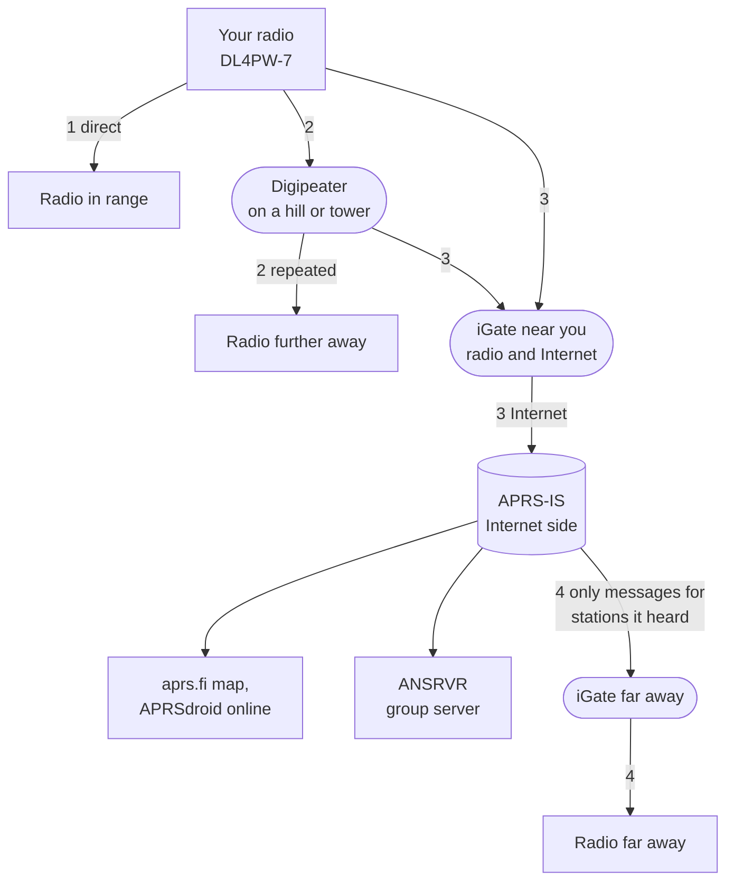
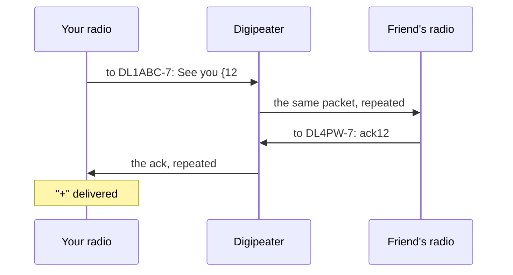
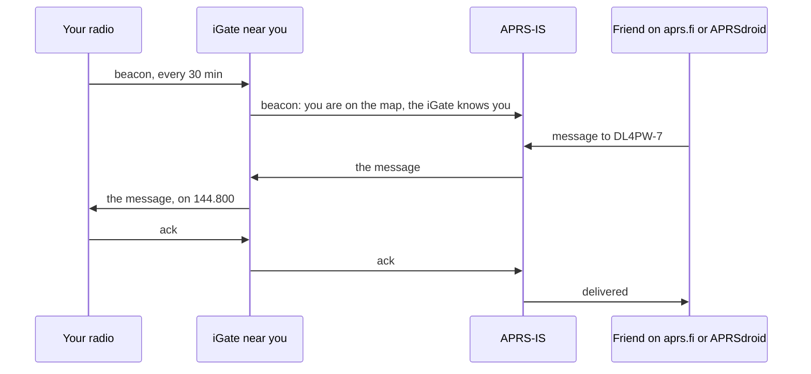
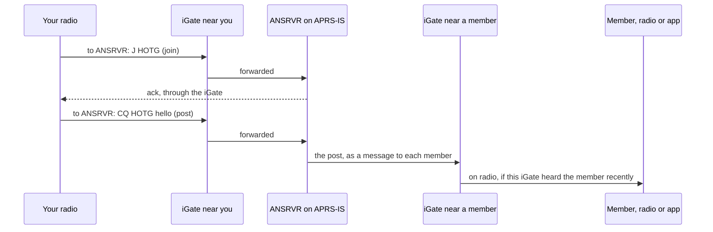

# How your messages travel

*Quick start: [QUICKSTART.md](QUICKSTART.md). Full guide: [README.md](README.md).*

APRS is one shared frequency (144.800 MHz in Europe) on which every station
sends short data packets. Some stations repeat what they hear (digipeaters),
some connect the radio side to the Internet (iGates). Whether a message
reaches someone depends on what kind of message it is and on the way it can
take. This page explains both, and which settings change what.

## The ways a packet can take



1. **Direct:** radio to radio, as far as your signal goes (a few km with a
   handheld, more from a hill).
2. **Through a digipeater:** a station on a high place repeats your packet.
   The *Path* setting asks for it: `WIDE1` one repeat, `WIDE1+2` up to two.
3. **To the Internet:** an iGate forwards everything it hears to APRS-IS.
   Your beacon then shows on aprs.fi, your messages reach people online.
4. **Back to radio, elsewhere:** an iGate only transmits **private messages
   (and acks) for stations it heard recently**, typically within the last
   half hour to a few hours, depending on the iGate. Positions, bulletins,
   channel and CQ messages never come back to radio this way. Many iGates
   only receive and never transmit at all.

So: everything local works through 1 and 2. Across the Internet only
private messages work, and only if an iGate near the recipient knows them.

## What each kind of message does

| You send | How (recipient field) | Who reads it | How far | Confirmed |
|---|---|---|---|---|
| **Private message** | a callsign, e.g. `DL1ABC-7` | only that station: any APRS radio or app, also on aprs.fi | ways 1 and 2; worldwide over 3 and 4 if an iGate near the recipient heard them recently | yes: `+` |
| **Channel** | **F** → `#WEBER` | radios with the same *Channel* (this messenger; Kenwood/Yaesu with that bulletin group) | ways 1 and 2 only | no, sent twice |
| **Public bulletin** | **F** → `#ALL` | everyone who shows bulletins: this messenger with *Public BLN* ON, the bulletin lists of Kenwood/Yaesu and APRS apps; online on aprs.fi | ways 1 and 2; seen online over 3, never back to radio elsewhere | no, sent twice |
| **Lobby** | **F** → `CQ` | stations that show messages to CQ: this messenger with *Lobby CQ* ON, Yaesu/Kenwood with the CQ group code | ways 1 and 2 only | no, sent twice |
| **IS net post** | **F** → `ANSRVR` ("CQ HOTG ...") | every member of the ANSRVR group, worldwide | over 3 to ANSRVR, which sends it to each member over 4 | the message to ANSRVR: yes |
| **Beacon** | sent by itself | everyone; the map on aprs.fi | ways 1, 2 and 3 | no |

**`#ALL` or `CQ`?** Both reach everyone around, without confirmation.
`#ALL` is a *bulletin*: a notice for a bulletin board ("club meeting Friday
8 pm"). Radios keep the last ten bulletins in a list, sorted by line number,
and many people never look at it. `CQ` is a *message* to everyone: it shows
up like a chat message, so it is the right choice for "anyone around for a
chat?". Our messenger keeps CQ messages by default (*Lobby CQ*), bulletins
only with *Public BLN* ON.

## A private message, step by step



Your radio sends the message with a number (`{12`); the friend's radio or app
answers with `ack12`. Until then your radio repeats the message after 30, 60,
120 and 240 s (`>` in the mailbox), then gives up (`!`; MENU sends it again).
Your messenger acknowledges messages for you the same way, by itself.

## From the Internet to your radio



This only works if an iGate in your range transmits and has heard you
recently. Your **beacon** makes sure of that. Check on aprs.fi: if your
callsign shows up there, an iGate hears you.

## The IS net (ANSRVR)

ANSRVR is a server on APRS-IS that keeps chat groups, e.g. `HOTG` for
#APRSThursday. It is not a radio feature: you talk to it with ordinary private
messages.



- **Join:** *IS net* = `HOTG`, then **F** on that item sends `J HOTG`.
- **Post:** recipient **F** → `ANSRVR`; the text starts with `CQ HOTG `, type
  after it. A post also joins.
- **Receive:** the group's posts arrive as private messages from `ANSRVR`.
- Membership ends after about 12 hours without activity. An iGate must hear
  you, and the members need one too (or an app on the Internet).

## One receiver for voice and APRS

Kenwood (TH-D74/D75) and Yaesu (FT3D/FT5D, FTM-400) APRS radios have two
receivers: APRS runs on one band all the time, voice on the other, and only
your own transmissions interrupt them. The UV-K1 and UV-K5 V3 have one
receiver, so voice (VFO A) and APRS (VFO B) take turns, like dual watch.

The trick that makes this work: every APRS packet starts with a preamble of
0.2-0.5 s before the data. The receiver does not have to sit on APRS all the
time; it only has to come back faster than a preamble lasts. Once it hears a
packet coming, it stays until the packet is over. Voice needs even less: a
short look is enough to notice a carrier, and the radio then stays on VFO A
for the whole call.

With *APRS hold* = **2 s** (the default) the receiver listens to APRS and
looks at VFO A for 0.1 s every 2 s:

```
VFO B (APRS)   [ listen 2 s ............. ]       [ listen 2 s ..
VFO A (voice)                               [look]
time (s)       0                            2     2.1
```

- **Voice** on VFO A is noticed within about 2 s; the radio then stays on
  VFO A, speaker on, for the whole call and for the *Voice hold* after it.
- **APRS:** a packet that starts while the receiver looks at VFO A is still
  caught by its preamble when it comes back 0.1 s later.

With **100 ms** (experimental) it alternates about as fast as plain dual watch:

```
VFO A (voice)  [look]          [look]          [look]
VFO B (APRS)         [ listen ]      [ listen ]      [ listen, packet: stays ... ]
time (s)       0     0.1       0.3   0.4       0.6   0.7
APRS packet                                       |-- preamble --|-- data --|
```

In every mode:

- **While you talk or listen on VFO A**, and for the *Voice hold* after it,
  APRS is deaf. Messages are not lost: the sender repeats them (after 30 s,
  1, 2 and 4 minutes).
- **Before your radio transmits** (an ack, a message, the beacon) it listens
  on VFO B for up to 6 s.

### Is the preamble long enough?

The preamble is set by the sender (its TXDELAY): 0.27 s on this firmware,
about 0.3 s on Direwolf, KISS TNCs and most digipeaters, adjustable on
Kenwood and Yaesu (usually 0.25-0.3 s), sometimes only 0.1-0.2 s on small
trackers. Switching back to VFO B and locking the decoder on takes about
0.15 s of it. A packet with a preamble of 0.2 s or more is therefore caught
in every setting; only short preambles that start during the look at VFO A
are lost. Estimates, not yet measured on the radio:

| *APRS hold* | Voice on VFO A noticed | Packets with 0.25-0.3 s preamble | with 0.1 s preamble |
|---|---|---|---|
| **100 ms** (experimental) | within about 0.3 s | practically all | about two thirds |
| **1 s** | within about 1 s | practically all | about 90 % |
| **2 s** (default) | within about 2 s | practically all | about 95 % |
| **5 s** | within about 5 s | practically all | about 98 % |
| **10 s** | within about 10 s | practically all | about 99 % |
| **ALWAYS** | only after your own transmission, for the *Voice hold* | all | all |

**ALWAYS** keeps the receiver on VFO B for good: nothing is missed, PTT still
transmits on VFO A, and VFO A is heard only for the *Voice hold* after your
own transmission. The *(!)* behind 100 ms on the radio marks it as
experimental.

**Voice hold** (4 s, 10 s, 20 s, 60 s; default 10 s): after you talk or listen
on VFO A, the receiver stays there that long before it goes back to APRS, so
your partner's answer is heard. F4HWN alone keeps 4 s after a transmission
and 1 s after a reception.

Dual watch must be on (RxMode `MAIN TX / DUAL RX`, see the quick start); with
dual watch off the receiver stays on the main VFO only.

## What your messenger keeps

The messenger is not a monitor: it keeps only what is meant for you.

| Kind | Kept when |
|---|---|
| Private messages | addressed to exactly your callsign and SSID (`DL4PW-7` is not `DL4PW`); always, and acknowledged |
| Channel messages | the group is your *Channel* |
| Public bulletins | *Public BLN* ON (off by default; they never beep) |
| Lobby (CQ, QST, ALL) | *Lobby CQ* ON (on by default) |
| IS net posts | you joined; they are private messages from ANSRVR |
| Messages between other stations, positions, weather, telemetry | never (the station list, key `2`, shows who was heard) |

Everything else on the frequency is counted (*RX* at the bottom of the setup)
but not kept. To see all traffic around you, use aprs.fi (raw packets near
your position) or the APRS RX app of F4HWN Labs.

## Settings that change the behaviour

| Setting | Effect |
|---|---|
| *Freq* + a VFO on it | without a VFO on exactly this frequency, nothing is received or sent |
| *APRS hold* | 100 ms (experimental), 1 s, 2 s (default), 5 s, 10 s: time on APRS before each 0.1 s look at VFO A. ALWAYS: APRS only |
| *Voice hold* | how long the receiver stays on VFO A after you talk or listen there |
| *Path* | how far your packets are repeated: DIRECT (way 1 only), WIDE1, WIDE1+2 |
| *Beacon* | makes iGates know you (needed for messages from the Internet) and puts you on aprs.fi |
| *Position*, *Locator* | where the beacon puts you on the map |
| *Channel* | which group's messages you get and where **F** sends first |
| *Public BLN*, *Lobby CQ* | whether public bulletins and CQ messages are kept |
| *IS net* | which ANSRVR group **F** offers and joins |
| *SSID* | part of your address: others must use exactly `CALL-SSID` |
