# APRS Messenger: quick start

*How messages travel (direct, digipeater, Internet, aprs.fi), with diagrams:
[HOW_IT_WORKS.md](HOW_IT_WORKS.md). Full guide: [README.md](README.md).*

Alpha firmware: the radio parts are not tested on a radio yet. Transmitting
needs an amateur radio licence; the radio sends acks and beacons by itself,
so keep an antenna connected.

## 1. Flash

1. With the official F4HWN Fusion on the radio, back up the calibration in
   [UV Studio](https://armel.github.io/uvstudio/#dump-calib) (once per radio).
2. Flash the Messenger edition from the
   [web flasher](https://technikweber.github.io/uv-k1-k5v3-aprs-firmware/).
   UV-K1 and UV-K5 V3 use the same file (not for the UV-K5 V1/V2).
3. UV-K1: the arrow keys are LEFT / RIGHT; everywhere below, UP = LEFT and
   DOWN = RIGHT.

## 2. The APRS channel on VFO B

The messenger listens and transmits on a VFO that you tune to the APRS
frequency; it never tunes a VFO itself. Set VFO B like this (or store it once
as memory channel `APRS` with **ChSave** / **ChName**, also possible with the
CHIRP driver of this fork):

| Menu | Value | Why |
|---|---|---|
| frequency | **144.800** (Europe/Africa; N. America 144.390, Australia 145.175) | must equal *Freq* in the messenger setup |
| **Mode** | FM | AM/USB cannot carry APRS |
| **W/N** | WIDE | APRS uses wide FM |
| **TxODir** | OFF | simplex: with an offset the messenger refuses to send |
| **RxCTCS / RxDCS** | OFF | a tone squelch would mute the packets |
| **TxCTCS / TxDCS** | OFF | no tone under the data |
| **Compnd** | OFF | the compander distorts the tones |
| **Power** | MID or HIGH | to reach the next digipeater (LOW for tests) |
| **Sql** | 1 or 2 | the messenger waits for a free channel |

**F + 2** switches between VFO A and B, **F + 3** between frequency and memory
mode; a frequency is typed on the keypad.

## 3. Voice and APRS together

- VFO A: your voice channel, selected as the main VFO (**F + 2**).
- **RxMode** = `MAIN TX / DUAL RX`: PTT always transmits on VFO A. Not
  `DUAL RX / RESPOND` (PTT could go out on 144.800) and not `CROSS BAND`.
- Only APRS: **RxMode** = `MAIN ONLY` with VFO B as the main VFO.
- The radio has one receiver. *APRS hold* in the messenger setup decides how
  it is shared: SHARE (default) keeps you reachable on VFO A, ALWAYS makes
  the radio an APRS receiver (see below).

## 4. The messenger

1. Menu → **F1Shrt** / **F1Long** / **F2Shrt** / **F2Long** / **M Long** →
   **MESSAGES**: that key opens the messenger.
2. First start: type your callsign without SSID, MENU. Then *Messenger* → MENU
   = ON.
3. Optional: *Channel*, *Locator*, *IS net* (below).

  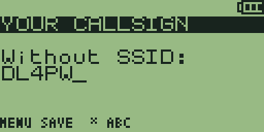
  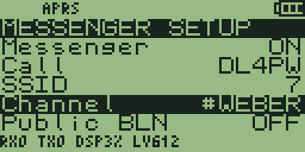

### Settings (F in the mailbox)

UP/DOWN selects an item, MENU or F changes it (or opens an editor).

- **Messenger** (ON): ON = the radio listens for APRS in the background, keeps
  messages for you and acknowledges them. OFF = nothing is received or sent.
- **Call**, **SSID** (7): your address. Others must write to exactly
  `CALL-SSID`, e.g. `DL4PW-7`; a message to `DL4PW` does not reach `DL4PW-7`.
  SSID 7 is usual for handhelds, 9 for cars, 0 means no SSID.
- **Channel** (empty, or as agreed): the name of your group, 1-5 letters or
  digits. Messages to `#NAME` (F in the recipient field) reach every radio
  with the same channel; radios with another channel ignore them. Local only:
  as far as the radio and digipeaters reach, never over the Internet.
- **Public BLN** (OFF): ON = also keep public bulletins, notices for everyone
  such as club news or net announcements (sent with `#ALL`). OFF = ignore
  them, the mailbox stays quiet. They never beep.
- **Lobby CQ** (ON): keep messages to `CQ`, `QST` or `ALL`, a call to everyone
  around that Yaesu and Kenwood radios show as well. OFF = ignore them.
- **IS net** (empty): a chat group on the Internet server ANSRVR, e.g. `HOTG`
  for #APRSThursday. MENU edits the name, **F joins**. Posts of the group then
  arrive as messages from ANSRVR, from anywhere in the world. Needs an iGate
  that hears you.
- **Beep** (ALL): ALL = beep for private, channel and lobby messages; PRIVATE
  = only for private ones; OFF = never. Public bulletins never beep.
- **Freq** (144.800 = VFO B): the frequency the messenger works on. It
  receives and sends only while a VFO is on exactly this frequency. MENU types
  it in, F steps through the APRS frequencies of other regions.
- **APRS hold** (SHARE): how the one receiver is shared with dual watch.
  SHARE = voice and APRS take turns: VFO A is heard as with normal dual watch,
  an APRS packet is caught by its preamble and heard to the end. ALWAYS = the
  receiver stays on VFO B: no APRS packet is missed, but VFO A is not heard
  (except for about 4 s after your own transmission). 10 s / 60 s = APRS
  first, VFO A is checked only that often. Details:
  [one receiver for voice and APRS](HOW_IT_WORKS.md#one-receiver-for-voice-and-aprs).
- **Encrypt**, **Key** (OFF): encrypted text between radios with the same
  key, only off the amateur bands (refused on 144-146 and 430-440 MHz). Other
  stations see only gibberish.
- **Path** (WIDE1+2): how often digipeaters repeat your packets. DIRECT = not
  at all, only stations and iGates in direct range hear you. WIDE1 = once,
  by a nearby digipeater. WIDE1+2 = up to twice, the usual setting.
- **Beacon** (30 min): how often your station announces itself (position or
  status). iGates only pass messages from the Internet to stations they heard
  recently, and aprs.fi only shows stations that send beacons. OFF = you are
  invisible and messages from the Internet do not reach you.
- **Status** (free text): the beacon text, up to 20 characters, also the
  comment of the position, e.g. `QRV 145.500`.
- **Position** (LOCATOR): where the beacon puts you on the map. OFF = no
  position, the beacon carries only the status. LOCATOR = the centre of the
  locator square. FIXED = the exact position from Lat/Lon. The radio has no
  GPS.
- **Locator**, **Lat**, **Lon**: your Maidenhead locator (`JO62QM`), or a
  fixed position: `485090` = 48°50.90', F switches N/S and E/W.
- **Symbol** (PERSON): the icon on the map.
- **APRS audio** (OFF): ON = the APRS packets are heard on the speaker
  (squawks). OFF = silent.
- **Clear mailbox**: deletes all messages after a question. `USED` = another
  program's data is in the messenger's flash area (see the warnings below).

The bottom line shows the bench figures: frames heard (RX) and sent (TX),
decoder load (DSP), audio level (LV); on some items it shows what MENU and F
do instead.

  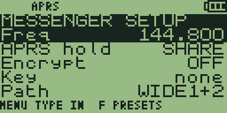

## 5. Keys

| Screen | Keys |
|---|---|
| Mailbox | UP/DOWN select · MENU read · `*` new · `1` chat with this station/channel · `2` stations heard · F setup · EXIT back |
| Reading | UP/DOWN scroll · MENU reply (own message without ack: send again) · F private reply to a group message · `0` delete |
| Writing | `0`-`9` multi-tap (`2` = a b c 2) · `*` Abc/abc/ABC/123 · UP/DOWN cursor · EXIT delete, held: cancel · MENU next / send |
| Recipient | a callsign, or **F**: your channel → `#ALL` (public bulletin) → `CQ` (lobby) → `ANSRVR` (IS net, text starts with "CQ group ") |

  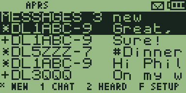
  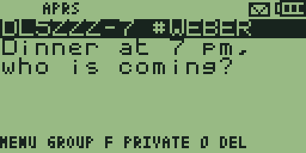
  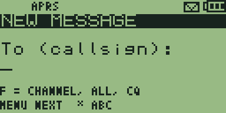
  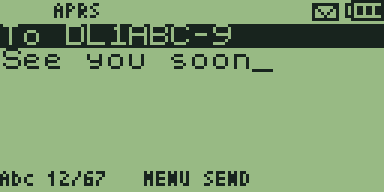

## 6. Examples

**Write to a friend** (private, with delivery confirmation)

1. Mailbox → `*` → the callsign with SSID, e.g. `DL1ABC-7` (`*` switches
   between letters and digits) → MENU.
2. Type the text → MENU sends it.
3. `>` while it is sent and retried, `+` once the friend's radio or app has
   confirmed it. Any APRS device works: Kenwood, Yaesu, APRSdroid, aprs.fi.
   A friend far away is reached through iGates if both of you are heard by one.

Shorter: `2` (stations heard) → select → MENU. To answer a message: open it →
MENU.

  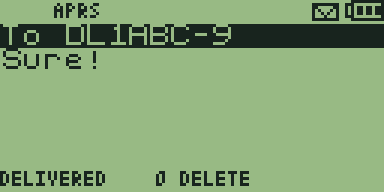

**Write to everyone in reach** (no confirmation)

- `*` → **F** until `CQ` → MENU → text → MENU. It goes out twice, a minute
  apart; every station in radio and digipeater range that shows CQ messages
  (Yaesu, Kenwood, this messenger) reads it. Answers come privately or as CQ.
- **F** once more gives `#ALL`, a public bulletin: a notice for everyone
  ("club meeting Friday 8 pm"). Radios file bulletins in a list of ten lines,
  which many people rarely open; this messenger keeps them only with *Public
  BLN* ON. `CQ` appears like a chat message instead, so use `CQ` to start a
  conversation and `#ALL` for announcements. Neither is confirmed, both reach
  as far as the radio and digipeaters, never over the Internet.

  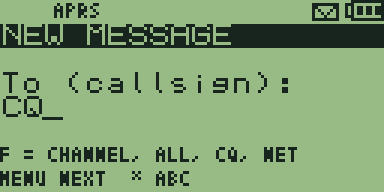
  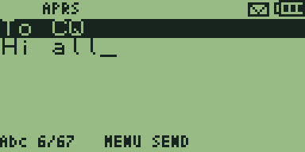

**Write to your group**

- Agree on a channel name (e.g. `WEBER`) and set it as *Channel* on every
  radio. Then `*` → **F** (`#WEBER`) → MENU → text → MENU. Every radio with
  that channel shows it with a beep; no confirmation, sent twice.

  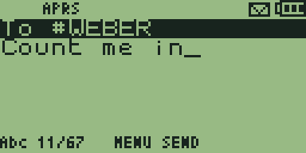

**Join the worldwide APRS chat** (e.g. #APRSThursday)

- *IS net* = `HOTG`, then **F** on *IS net* to join. `*` → **F** until `ANSRVR`
  → MENU → write after "CQ HOTG " → MENU. The group's messages arrive from
  ANSRVR. Needs an iGate that hears you (beacon on); after about 12 hours
  without activity, post or join again.

  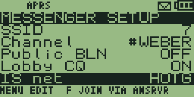
  

**Show up on the map**

- *Locator* (e.g. `JO62QM`) and *Beacon* 30 min: aprs.fi shows your position
  with the *Status* text.

  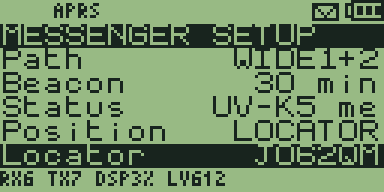

**See who is around**

- `2` in the mailbox: the stations heard, newest first, with the time since.

  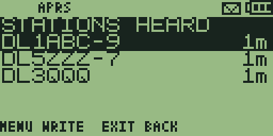

**Encrypted group chat** (only where encryption is allowed)

- On every radio: the same *Freq* off the amateur bands, a VFO on it, the same
  *Key*, *Encrypt* ON. Then write to the channel as above; 40 characters at
  most.

  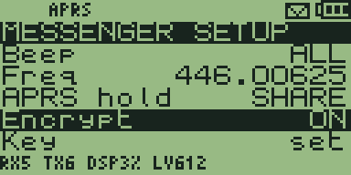
  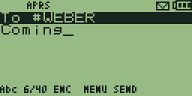

## 7. What the display tells you

- Status bar **`APRS`**: the messenger listens on VFO B right now. Envelope:
  unread messages.
- Marks: `*` new · `>` sending (retries after 30, 60, 120, 240 s) · `+`
  delivered · `!` no ack or rejected (MENU sends again) · `#` group or lobby.
- Warnings at the bottom of the mailbox:

| Warning | Fix |
|---|---|
| `NO VFO ON 144.800` | tune a VFO to *Freq* |
| `SELECT APRS VFO OR DUAL WATCH` | dual watch is off (or the FM radio is on) and VFO B is not the main VFO |
| `TX BLOCKED: CHECK FM/SIMPLEX/LOCK` | Mode, TxODir or TX lock of VFO B |
| `TX BLOCKED: BATTERY` | charge |
| `FLASH IN USE: CLEAR MAILBOX` | another program's data (e.g. F4HWN apps) in the messenger's flash area; the setup shows *Clear mailbox* `USED`. Clearing asks again and erases that data |

  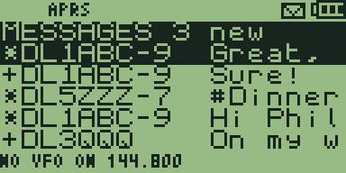
  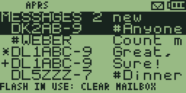
  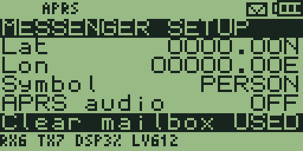
  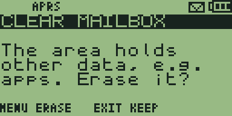

## 8. Why do I receive nothing?

1. **Status bar:** is `APRS` there? If not: *Messenger* ON, a VFO on the
   *Freq* frequency, and dual watch on or VFO B as the main VFO (section 3).
2. **Setup, bottom line:** does *RX* count up? It counts every APRS packet
   decoded. If it stays at 0 for minutes: wrong frequency, no antenna, or
   nobody active near you (aprs.fi shows the stations around you). *LV* 0
   means the receiver is not on the APRS VFO.
3. **RX counts, but the mailbox stays empty:** normal. Most packets are
   positions and weather reports, and messages between other stations are not
   kept (see [what your messenger keeps](HOW_IT_WORKS.md#what-your-messenger-keeps)).
   Key `2` shows who was heard.
4. **A friend's message does not arrive:** the friend must use your exact
   callsign with SSID, be on the same frequency and within radio or
   digipeater range (or reach you through iGates).
5. **Messages from the Internet do not arrive:** an iGate near you must hear
   you and transmit. Keep the beacon on and look yourself up on aprs.fi: if
   you are not there, no iGate hears you.
6. **Channel messages do not arrive:** the same *Channel* on every radio.
   **CQ messages:** *Lobby CQ* ON. **Bulletins:** *Public BLN* ON.

## 9. Good to know

- **One receiver:** while you talk or listen on VFO A, or scan, APRS is deaf.
  Missed messages usually arrive with the sender's next retry.
- **APRS hold SHARE** (default) keeps you reachable on VFO A. While a voice
  call is on, APRS is deaf; messages arrive with the sender's next retry.
  **ALWAYS** never misses a packet, but you hear VFO A only for about 4 s
  after your own transmission. The messenger never leaves VFO B during a
  packet or while an ack waits to go out.
- **FM radio:** the firmware pauses dual watch; select VFO B as the main VFO
  first, or APRS stays deaf.
- **Battery:** power save stays off while a VFO is on the APRS frequency.
- **Automatic transmissions:** acks 0.7-3 s after the channel is free, beacons,
  retries; at most 6 frames at once, then one per 30 s.
- **Limits:** 67 characters per message (40 encrypted); umlauts become
  ae/oe/ue/ss; up to 480 messages, the oldest 32 go when full; no time stamps
  (the radio has no clock).
- **Messages from the Internet** (aprs.fi, APRSdroid via APRS-IS) need an
  iGate that heard you recently: keep the beacon on.
- **CHIRP:** use the driver of this fork, `chirp/f4hwn.messenger.chirp.py`;
  the F4HWN driver resets the MESSAGES key.
- **Not in this edition:** spectrum analyser, RF Log, QR codes, logo screen
  saver, overlay apps (F4HWN Labs can sit in a Multiboot slot).
