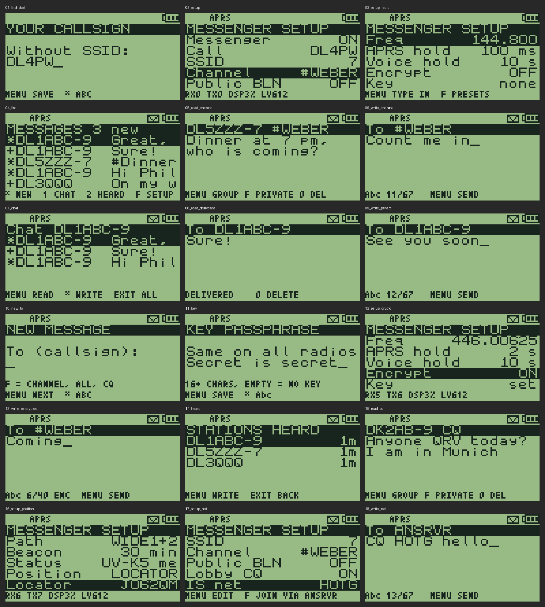

# APRS messenger

Text messages over APRS, without a phone or a computer. The radio decodes APRS
in the background while it works as usual, acknowledges messages for your
callsign, keeps them in a mailbox in its flash, beeps and shows an envelope.
You read and answer them later, typing on the number keys: privately to one
station, to everyone in your channel, or to the lobby (`CQ`).

**Quick start:** [QUICKSTART.md](QUICKSTART.md) (examples, all settings, the
APRS channel on VFO B, voice and APRS together).



> [!WARNING]
> **Status: built and tested on the host only.** Every part that runs without
> the radio has host tests (protocol, demodulator on simulated audio,
> mailbox on a simulated NOR flash, messenger logic, text entry, screens).
> The parts that touch the hardware (audio capture, transmitter, beeps) have
> not run on a radio yet. Check them with the [bench tests](#bench-tests)
> before relying on it.

## What you need

- A **Quansheng UV-K1 or UV-K5 V3** (PY32F071). The UV-K5 V1/V2 cannot run it.
- An **amateur radio licence**: APRS transmits.
- One VFO on the **APRS frequency** (144.800 MHz in IARU Region 1), FM, wide.

## Build and flash

**From the browser:** the
[web flasher](https://technikweber.github.io/uv-k1-k5v3-aprs-firmware/) opens
UV Studio with the latest build of this branch already loaded (GitHub Actions
builds it with the same toolchain as upstream, after the host tests pass).
Numbered builds with their notes: [releases](https://github.com/TechnikWeber/uv-k1-k5v3-aprs-firmware/releases)
(image, checksum and CHIRP driver).

**Yourself:**

```
cmake --preset Messenger
cmake --build --preset Messenger
```

The image is `build/Messenger/f4hwn.messenger.bin`. Flash it like any F4HWN
Fusion release, with [UV Studio](https://armel.github.io/uvstudio/), and back up
the calibration data first.

The Messenger edition is F4HWN Fusion v6.3 plus the messenger, minus a few
features to make room: see [Differences to F4HWN Fusion](#differences-to-f4hwn-fusion).

### Differences to F4HWN Fusion

**Removed** (the 118 KiB of the MCU are nearly full):

- the spectrum analyser (`F` + `5`);
- the RF Log (RX/TX activity log), so also UV Studio's RF Log dashboard;
- the QR codes on the system information pages (they link to the F4HWN
  project anyway);
- the logo screen saver (the boot logo stays).

**Not included, as in Fusion v6.3:** the overlay apps (APRS RX/TX/DIGI, KISS
TNC, ...: F4HWN Labs). To use one, keep F4HWN Labs in a Multiboot slot and
switch at power-on (hold `MENU`); the apps' flash area and the messenger's do
not overlap. Messenger and apps in one firmware need F4HWN v7 (see
[TODO.md](TODO.md)).

**Works as in Fusion:** everything else, and with UV Studio: flashing,
calibration dump/restore, K5Viewer (also the messenger screens), Multiboot and
Multiconfig.

**CHIRP:** the F4HWN driver does not know the side-key action MESSAGES; it
shows NONE and resets the key when it writes the settings. Use the driver of
this fork, [`chirp/f4hwn.messenger.chirp.py`](../../chirp/f4hwn.messenger.chirp.py)
(also in the releases and on the web flasher page): the F4HWN v6.3.0 driver
plus that action, same memory layout, images interchangeable. In CHIRP:
*File → Load Module* (newer versions show it after *Help → Developer Mode*).

**Updating from v0.1:** the settings and the mailbox moved to a new flash
region (see [Flash region](#flash-region)), so they start empty: enter the
callsign again. The old region is left as it was.

### Calibration and going back

The radio's calibration (512 bytes, one per radio) lives in the external
flash at 0x010000. Flashing a firmware only rewrites the MCU's internal flash
through the bootloader, which sits in its own area and is never overwritten;
the messenger itself writes only its region 0x1BA000-0x1C9FFF (see
[Flash region](#flash-region)). Still, do as the F4HWN README recommends:

1. Flash the official F4HWN Fusion first, then **dump the calibration** with
   UV Studio and keep the file, named after the radio's serial number (label
   under the battery).
2. Then flash the Messenger edition.
3. Before going back to the stock Quansheng firmware (or to another custom
   one), **restore** that calibration file with UV Studio.

## First steps

1. **Side key:** Menu → the side key settings (`F1Shrt`, `F1Long`, `F2Shrt`,
   `F2Long` or `M Long`) → **MESSAGES**.
2. Press it. The first time it asks for **your callsign** (without SSID; it is
   taken from the boot message if that looks like one): type it, MENU.
3. The setup opens on **Messenger**: MENU switches it ON. Set the **SSID**
   (7 is usual for handhelds) and, if you like, a **Channel** (below).
   Later, **F** in the mailbox opens the setup again.
4. Tune a VFO to **144.800 FM**, squelch low (1 or 2), and leave it there:
   alone, or as one side of dual watch (see *APRS hold* below). Easiest: a
   memory channel named `APRS` (144.800, FM, wide, no offset, no tones; also
   with CHIRP) on VFO B. The messenger does not tune a VFO by itself.
5. Optional: your **Locator** (e.g. `JO62QM`) or a fixed **Lat**/**Lon** in
   the setup: the beacon then carries your position and maps show you.
6. 20 seconds later the radio sends its first beacon, then one every
   30 minutes. iGates only route messages from the Internet to stations they
   have heard recently.

## Keys

| Screen | Key | Action |
|---|---|---|
| Mailbox | UP / DOWN | select |
| | MENU | read |
| | `*` | new message (in a chat: to that station or channel) |
| | 1 | chat: only the messages with this station, or of this channel |
| | 2 | stations heard: MENU writes to the selected one |
| | F | setup |
| | EXIT | back to the main screen (in a chat: back to all messages) |
| Reading | UP / DOWN | scroll |
| | MENU | reply: to the sender, or into the channel of a broadcast; send again (own message without ack) |
| | F | broadcast: reply privately to its sender |
| | 0 | delete (asks first) |
| Writing | 0-9 | multi-tap: `2` = a b c 2, `0` = space 0, `1` = `. , ? ! ' - / : @ ( ) + = * # 1` |
| | `*` | Abc → abc → ABC → 123 |
| | UP / DOWN | cursor left / right |
| | EXIT | delete; on an empty text back to the recipient; held: cancel |
| | MENU | recipient: next; text: send |
| | F | recipient: your channel, `#ALL` (public bulletin), `CQ` (lobby), `ANSRVR` (IS net) in turn |
| Setup | UP / DOWN | select |
| | MENU / F | next / previous value, or edit |

A letter is fixed one second after the last tap, or at once with another key.
Messages hold up to 67 characters (the APRS limit).

**UV-K1:** its arrow keys are LEFT / RIGHT. Where this guide says UP / DOWN,
LEFT is UP and RIGHT is DOWN, as in the F4HWN menus (the same firmware runs
on both radios; the menu `SetNav` sets the layout).

### Mailbox marks

| Mark | Meaning |
|---|---|
| `*` | new, not read |
| (blank) | read; or a broadcast you sent |
| `#` before the text | a broadcast in a channel, or a lobby message |

Reading an encrypted message shows `ENC` in front of the key hints.
| `>` | sending: waits for the ack, retries after 30, 60, 120 and 240 s |
| `+` | delivered (acknowledged) |
| `!` | no ack after 5 transmissions, or rejected: MENU sends it again |
| `-` | sent before a restart, no ack yet |

## Private messages and channels

APRS has two kinds of text:

- **Messages** go to one callsign. The receiving radio or app acknowledges
  them; your radio shows `+` (delivered) once the ack is back. This is an
  end-to-end confirmation from the recipient, not from a digipeater.
- **Bulletins** go to everyone and are not acknowledged. A bulletin can name a
  **group** (`BLN0WEBER`): that is the channel here, like a Meshtastic channel.

So the messenger has:

- **Your channel** (setup *Channel*, 1-5 letters or digits, e.g. `WEBER`).
  Broadcasts in it reach every radio with the same channel. In the editor,
  **F** on the recipient puts the channel there, MENU goes on to the text.
  Each broadcast goes out twice, a minute apart, because there is no ack.
- **Public bulletins** (setup *Public BLN*, off by default): bulletins without
  a group, from anyone (club news, nets, contests). Off keeps the mailbox
  quiet; they never beep.
- **F** in the recipient field also offers `#ALL`: a public bulletin.

And two kinds of lobby, for talking to strangers:

- **CQ, QST, ALL** (setup *Lobby CQ*, on by default): messages to these
  addressees are read by every station that shows them; Yaesu and Kenwood
  radios have them as group codes. They are not acknowledged; your own goes
  out twice, a minute apart. Reach: as far as the radio and the digipeaters.
- **IS net** (setup *IS net*, e.g. `HOTG` for #APRSThursday): a group on the
  APRS-IS server ANSRVR, worldwide through iGates. **F** on *IS net* sends the
  join (`J HOTG`); in the recipient field **F** offers `ANSRVR`, and the text
  then starts with `CQ HOTG `, which posts it to the group. The group's
  messages come from ANSRVR as normal private messages. ANSRVR ends a
  membership after about 12 hours without activity; posting joins again.

Everything on APRS is readable by everyone, private messages included:
amateur radio does not allow encryption. Choose a channel name others are
unlikely to use, but do not treat it as private.

## Encryption (only where it is allowed)

> [!CAUTION]
> **Encryption is forbidden in amateur radio.** Use it only on frequencies and
> with equipment where the rules of your country allow encrypted data, for
> example some licence-free bands. Those rules (frequencies, power, antenna,
> type approval, data transmission) differ from country to country; checking
> and following them is **your own responsibility**. Encryption is off by
> default.

The firmware refuses to send encrypted on 144-146 MHz and 430-440 MHz (the
IARU Region 1 amateur bands); other countries' allocations are not detected.
A message that waits for its retries is never sent in the clear instead: if
encryption becomes impossible (key removed, frequency moved to an amateur
band), it is marked `!` and stays unsent.

**Setup:**

1. *Freq*: MENU types a frequency in (digits only, three for the MHz:
   `44600625` = 446.00625 MHz), F steps through presets (the APRS frequencies
   and PMR446 channel 1). Tune a VFO to the same frequency.
2. *Key*: a passphrase, the same on every radio of the group, at least 16
   characters. Only the derived key is stored; the passphrase is not kept.
   An empty passphrase removes the key.
3. *Encrypt*: ON. It shows `HAM: OFF` while the frequency is in an amateur band.

**What it protects:** the text of private messages and channel broadcasts,
with ChaCha20 (RFC 8439) and a 32-bit SipHash-2-4 tag, so a wrong key or a
changed message is detected. A message cannot be replayed under another
sender or to another recipient. **What it does not hide:** callsigns, the
channel name, message numbers, acks and timing: APRS needs them to deliver.
Encrypted text is limited to 40 characters (base64 must still fit the
67-character APRS limit). A message for you with another key shows as
*(encrypted, other key)*. Anyone with your radio can read its key from the
flash.

## How it behaves

- **Status bar:** `APRS` in place of the dual watch mark (`DW`, hold, `MO`)
  means the messenger is on and the receiver listens on the APRS VFO. When
  dual watch looks at the other VFO, or the APRS VFO is not receiving, the
  usual mark is back. The APRS VFO itself is the one you tuned to the APRS
  frequency; the messenger does not retune or mark VFOs.
- **APRS stays silent.** With *APRS audio* off (default), a burst on the APRS
  frequency does not open the speaker and does not interrupt the FM radio;
  only dual watch holds on that VFO until the burst ends.
- **APRS hold** (default *ALWAYS*): with dual watch on, the receiver stays on
  the APRS VFO, so no burst is missed; the other VFO can still transmit (MAIN
  TX). With *10 s*, *30 s* or *60 s* it stays that long, then dual watch looks
  at the other VFO as usual (100 ms, longer while a signal is there) and comes
  back. It never leaves during a burst or within 1.5 s after one, nor while an
  ack or a message waits to go out (up to 6 s). Your dual watch setting
  itself is not changed.
- **Acks** go out by themselves, 0.7 to 3 s after the channel is clear.
  Copies of a message through other digipeaters are not acknowledged again;
  a retry of the sender (30 s or more later) is.
- **Safety limits:** at least 3 s between two of its own frames, at most 6 in a
  burst, then one per 30 s. Nothing is sent while you transmit, receive,
  scan, or while the channel is busy.
- **Power save** stays off while a VFO is on the APRS frequency: the receiver
  must hear the start of each burst. This costs battery.
- **The FM radio** keeps playing; APRS bursts may be heard faintly over it
  (the BK4829 audio has to be on for the decoder while a burst comes in).
- **Messages from the Internet** (APRS-IS, aprs.fi, APRSdroid via an iGate)
  arrive as third-party frames and are handled like local ones; the ack goes
  to the original sender.
- **Umlauts:** received UTF-8 or Latin-1 umlauts become ae, oe, ue, ss.

## Setup items

| Item | Values |
|---|---|
| Messenger | ON / OFF (needs a callsign) |
| Call, SSID | your station; SSID 0 = none |
| Channel | your group for broadcasts, 1-5 letters/digits; empty = none |
| Public BLN | also keep public bulletins (OFF / ON) |
| Lobby CQ | keep messages to CQ, QST and ALL (ON / OFF) |
| IS net | ANSRVR group (1-9 letters/digits), `none`; MENU edits, F joins |
| Beep | ALL (private, channel and lobby), PRIVATE (only private), OFF |
| Freq | MENU: type in (`14480000` = 144.800); F: presets 144.800, 144.390, 144.640, 144.660, 145.175, 145.825, 446.00625 |
| APRS hold | ALWAYS, 10 s, 30 s, 60 s: dual watch stays on the APRS VFO always, or that long before a look at the other VFO |
| Encrypt | OFF / ON (needs a key; never on amateur bands) |
| Key | passphrase for encryption; `set` / `none` |
| Path | DIRECT, WIDE1 (WIDE1-1), WIDE1+2 (WIDE1-1,WIDE2-1) |
| Beacon | OFF, 10, 20, 30, 60 min: the position (`=4850.90N/00216.25E[`) with the status as comment, or the status alone (`>text`) |
| Status | beacon text, up to 20 characters |
| Position | OFF, LOCATOR, FIXED: where the beacon position comes from |
| Locator | Maidenhead, 4, 6 or 8 characters; the beacon uses the centre of the square |
| Lat / Lon | fixed position: MENU types `DDMMmm` / `DDDMMmm` (`485090` = 48 50.90), F switches N/S or E/W |
| Symbol | PERSON, HOUSE, CAR, BIKE, BOAT, PORTABLE |
| APRS audio | ON: bursts on the APRS frequency are heard as usual |
| Clear mailbox | erases all messages (asks first) |

Typing a locator sets *Position* to LOCATOR, typing Lat or Lon sets it to
FIXED.

The bottom line shows bring-up figures: frames heard (`RX`) and sent (`TX`),
decoder load (`DSP`, % of the CPU), audio level at the ADC (`LV`, peak to peak
in ADC codes over 100 ms) and late decoder blocks (`OV`, only when there are any).

## Bench tests

Two radios, both with this firmware, call A and B, VFOs on 144.800 (or a
free simplex frequency for the first tests, set under Freq on both).

1. **Audio level.** Setup on A, no signal: `LV` shows noise (squelch closed
   or open), `DSP` a few %. A burst from B (or any APRS station): `LV` should
   reach several hundred. 0 means the capture does not run (no VFO on the
   frequency, or messenger off).
2. **Receive.** Send from B to A. On A: two tones, envelope, `RX` counts up,
   the message is in the mailbox. B shows `+` after a few seconds.
3. **FM radio.** Play the FM radio on A, send from B: does the message arrive,
   how loud is the burst over the music, does the music continue?
4. **Dual watch.** A: VFO A on 144.800, VFO B on a voice channel, dual watch on.
   *APRS hold* ALWAYS: the status bar shows `APRS`, every message from B
   arrives. *10 s*: `DW` flashes up every 10 s; messages still arrive (retries
   help); a voice call on VFO B is heard within about 10 s.
5. **Key beeps.** Press keys on A with key beep on, then send from B: must
   still decode (the messenger switches the BK4829 audio back on).
6. **Battery reading.** The battery voltage on A must stay plausible while the
   messenger runs (the capture lends the ADC to the battery measurement).
7. **Channel.** Same channel on A and B: a broadcast from B shows on A with
   `#`, beeps (Beep ALL), and is not acknowledged. Another channel on A: nothing.
8. **Real network.** Beacon on, wait for the status to show on aprs.fi, then
   send a message from aprs.fi or APRSdroid to A, and from A to that station.
9. **Current draw.** Standby with and without the messenger.

Report anything odd with a photo of the setup screen (the bottom line).

## Host tests

```
App/messenger/test/run.sh [OUTDIR]
```

builds and runs everything on the PC (gcc, python3; the demodulator test
generates its audio with the channel model of the APRS RX app). The screen
simulator writes `OUTDIR/screens/*.lcd`; `test/render_lcd.py OUTDIR/screens`
turns them into PNG files like the one above.

## Flash region

The settings and the mailbox use 64 KiB of the external flash at
0x1BA000-0x1C9FFF: blank on factory radios, not used by F4HWN v6 or v7
(v7 keeps it as a reserve for overlay-app slots 92-99 and puts its firmware
assets above it). Before writing, the messenger checks that every sector holds
only its own records or erased flash. If another program's data is found
there, nothing is written and the mailbox shows *FLASH IN USE*; *Clear
mailbox* then takes the region over (that other data is lost).

## Not yet

- Predictive T9 (a word list in the external flash): only multi-tap so far.
- Times: the radio has no clock; the mailbox keeps the order only.
- Positions and distances in the station list (needs Mic-E decoding).

Open points and bench topics: [TODO.md](TODO.md).

Design notes: [DESIGN.md](DESIGN.md).

## Receiver sharing and review fixes

For voice plus APRS, set one VFO to the messenger frequency in FM/Wide,
with zero TX offset and no compander or receive tone filter. Set the other
VFO to the voice channel, select it as main, and choose MAIN TX / DUAL RX.
Changing Messenger Freq does not tune either VFO automatically. With *APRS
hold* ALWAYS (default) you transmit on the voice channel but hear only APRS;
choose 10, 30 or 60 s to hear the voice channel too, with gaps in APRS.

There is one voice/APRS receiver. Voice reception and PTT cause APRS gaps.
Before an automatic transmission the messenger holds the APRS VFO for up to
six seconds to listen and complete its random channel-access delay, followed
by a two-second interval without that hold. This can delay voice reception.
Reception is decoded only on the configured APRS frequency; scanning pauses it.
A VFO with different RX and TX frequencies is refused for APRS transmissions.
The mailbox displays TX lock and battery failures.

During broadcast FM listening, dual watch is suspended by the base firmware:
select the APRS VFO before enabling FM radio. The messenger restores AF mute
when the burst ends. This audio behavior still requires verification on hardware.

Deleting messages cancels their pending sends; clearing the mailbox cancels
all message and bulletin sends. Failed storage and unreadable encrypted
messages do not generate delivery acknowledgements. A wrong-key notice remains
visible in the mailbox. New arrivals update an open mailbox automatically.
